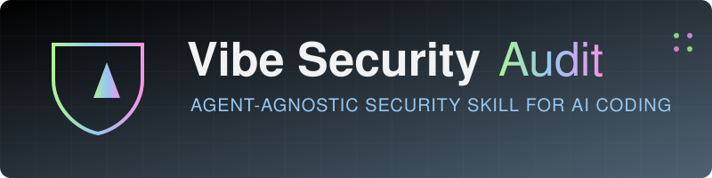

<div align="center">

  <!-- 3D DYNAMIC WAVING BANNER -->
  

  <!-- 3D ANIMATED PROJECT ICON -->
  <a href="https://github.com/OPSHARP/Vibe-Security-Skill">
    
  </a>

  <h1>Vibe Security Audit Skill</h1>
  <p><b>🛡️ 30-Point Deep Security Audit for AI & Vibe-Coded Projects</b></p>

  <!-- 3D TECH STACK CARDS -->
  <p align="center">
    <a href="https://skillicons.dev">
      
    </a>
  </p>

</div>

---

# Vibe Security Audit Skill



An AI agent skill that performs a comprehensive 30-point security audit on codebases, specifically designed to catch vulnerabilities common in AI-assisted ("vibe coded") projects.

Works with any AI coding agent that supports custom skills, including GitHub Copilot, Claude, Windsurf, and others.

> Read the blogpost here: https://ladydev.me/secure-vibecoding

## What It Does

This skill audits your codebase for security issues across three categories:

### 🚨 Critical Checks (5 checks)
- **Secrets Exposure** — API keys, tokens, passwords in source code
- **Custom Auth Vulnerabilities** — Hand-rolled authentication patterns
- **Injection Attacks** — SQL injection, XSS, command injection
- **CORS Misconfiguration** — Overly permissive cross-origin settings
- **Missing Auth on Routes** — Unprotected API endpoints

### 🔍 Standard Checks (15 checks)
- Ghost packages and dependency typosquatting
- Outdated dependencies with known vulnerabilities
- Missing rate limiting
- Attack surface mapping
- Input validation gaps
- And more...

### 🚀 Production Readiness Checks (10 checks)
- AI cost controls
- GDPR/account deletion compliance
- Backup strategies
- Error handling and logging
- Environment configuration

## Installation

1. **Clone this repository:**
   ```bash
   git clone https://github.com/LadyKerr/Vibe-Security-Skill.git
   ```

2. **Copy the skill to your agent's skills directory:**

   | Agent | Skills Directory |
   |-------|------------------|
   | GitHub Copilot | `.github/skills/` |
   | Claude | `.claude/skills/` |
   | Windsurf | `.windsurf/skills/` |
   | Other agents | Check your agent's documentation |

   ```bash
   # Example for GitHub Copilot
   cp -r vibe-security-audit .github/skills/

   # Example for Claude
   cp -r vibe-security-audit .claude/skills/

   # Example for Cursor
   cp -r vibe-security-audit .cursor/skills/
   ```

3. **Commit the skill to your project** (recommended for team-wide use):
   ```bash
   git add .github/skills/  # or your agent's skills directory
   git commit -m "Add vibe security audit skill"
   ```

## Usage

Ask your AI agent to run a security audit:

```
Run a vibe security audit on this project
```

Or focus on specific areas:

```
Run a security audit focused on authentication
Audit the API routes for security issues
Check this codebase for production readiness
```

## Output

The skill generates a security report with:
- **Detected tech stack** (framework, database, auth, deployment)
- **Project score** (0-100)
- **Issues found** with severity ratings
- **Quick wins** — issues fixable in under 10 minutes
- **Detailed findings** with remediation steps

### Severity Scale

| Score  | Level         | Action Required           |
|--------|---------------|---------------------------|
| 10/10  | Critical      | Fix before deploying      |
| 8-9/10 | High          | Fix within 24 hours       |
| 6-7/10 | Medium        | Fix within 1 week         |
| 4-5/10 | Low           | Fix when convenient       |
| 1-3/10 | Informational | Consider addressing       |

## License

MIT — See [LICENSE](LICENSE) for details.

## Author

Created by [Kedasha](https://github.com/LadyKerr) | [@itsthatladydev](https://www.instagram.com/itsthatlady.dev/)

---

<div align="center">
  
</div>
